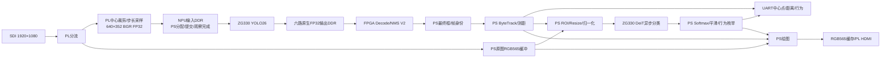

# 当前数据流与下一步流水线

版本：2026-10-26，POST V2正式接入；已验证范围见README及运行CSV。

经过DDR不等于CPU逐像素中转。PS目前仍负责缓冲地址、所有权、硬件启动与完成检查。

| 阶段 | 执行位置 | 本轮情况 |
|---|---|---|
| 检测输入采样/格式转换 | PL | 正常运行不走CPU输入桥；周期性回读诊断仍保留 |
| 检测主网 | NPU | 实时forward约31ms；固定输入旧测约27ms |
| Decode/NMS | PL | 1107次成功，平均约3.882ms；当前比此前CPU约0.44ms更慢，不能称吞吐加速 |
| 跟踪/测距/协议/绘图 | PS | 保留 |
| 分类预处理 | PS | 本轮约4.9ms/次；PL CLASS尚未接入生产路径 |
| 分类主网 | NPU | 计算及读回/reset约50ms/次；与检测共享计算资源 |

已有相机、NPU和显示独立线程、输入多缓冲、分类一个运行任务加一个可替换等待任务。POST目前在检测线程内、输出就绪之后及reset之前执行，保证六路内存不会被复用。随后显示/跟踪只消费最终框。

下一步流水线方向：
1. 显示按独立节奏消费最新原图和已完成结果，逐帧保留硬件/软件身份、结果年龄与丢帧记录；不能把旧框当同帧框。
2. 明确每个输入/输出槽 FREE→WRITING→READY→READING→FREE，将POST与下一帧NPU计算重叠；需先证明SDK reset/MMU切换及共享DDR访问不会破坏PL读出，不能直接移除锁。
3. 分类采用独立时间预算和检测优先调度；减少分类占用只能减少等待，不能让共享NPU的两次计算同时进行。

单网络60FPS需要检测服务时间降到16.67ms以内。官方YOLOv5卷积为INT8，当前YOLO26卷积为BF16；两者输入均640×352，不能仅因分辨率一样推断性能一致。量化/更小模型应与流水线优化分别测量；若改变输出dtype/布局，必须同步核对FPGA POST契约。
